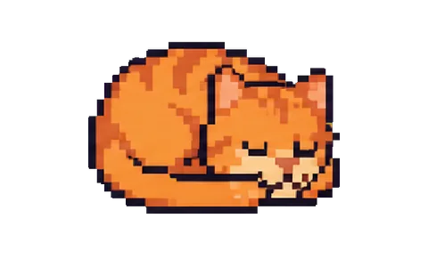

# PauseMeow

<p align="center">
  
</p>

> **When the cat says pause.**

PauseMeow is a free, local work-and-break timer for Windows and Linux. When
your work interval ends, an animated cat takes over every monitor, dims the
desktop, lies down, purrs, and stays until your break is over. It is built with
C++20, Qt 6, and QML and works without an account or telemetry.

## Download

Download PauseMeow 1.0.0 from the
[latest GitHub release](https://github.com/ladosha/PauseMeow/releases/latest).

### Windows

Download `PauseMeow-1.0.0-windows-x64-portable.zip`, extract the entire archive
to a stable location, and run `PauseMeow.exe`. No installer or administrator
access is required. The GitHub build is unsigned, so Windows may display a
SmartScreen warning. The Microsoft Store release is coming soon.

### Linux

Download `PauseMeow-1.0.0-x86_64.AppImage`, make it executable, and run it:

```bash
chmod +x PauseMeow-1.0.0-x86_64.AppImage
./PauseMeow-1.0.0-x86_64.AppImage
```

Keep a portable build in a stable location after enabling autostart. PauseMeow
stores settings and autostart registration per user, outside the application
directory.

## Features

- separate work and break durations;
- smooth cat entrance, settling down, sleeping, waking up, and leaving;
- full-screen break mode on every connected monitor;
- an optional custom break message, limited to 120 characters for readability;
- background dimming and a strict mode without an early-finish button;
- a click reaction and an annoyed reaction to four rapid clicks;
- synchronized footsteps and purring while walking, plus background purring
  during breaks;
- three independent switches for these sounds;
- a mandatory meow during the annoyed four-click reaction;
- work-timer pause and system-tray controls;
- persistent settings and per-user autostart;
- accurate monotonic-clock countdowns, including after the computer resumes
  from sleep.

PauseMeow is designed around the cat interaction rather than as another generic
Pomodoro interface: the cat enters, reacts to clicks, settles down, sleeps, and
leaves when the break is complete.

Run the prepared portable build from:

```text
dist\PauseMeow.exe
```

To preview an eight-second break:

```powershell
.\dist\PauseMeow.exe --demo
```

To clear all settings and disable autostart:

```powershell
.\dist\PauseMeow.exe --reset-settings
```

## Building

Requirements: Visual Studio 2022 with MSVC, CMake 3.24+, and Qt 6.8+ for
MSVC 2022 x64 with the Qt Multimedia module.

```powershell
cmake -S . -B build -G "Visual Studio 17 2022" -A x64 `
  -DCMAKE_PREFIX_PATH="C:\Qt\6.8.3\msvc2022_64" `
  -DBUILD_TESTING=ON
cmake --build build --config Release --parallel 4
ctest --test-dir build -C Release --output-on-failure
```

To prepare a portable directory after building:

```powershell
C:\Qt\6.8.3\msvc2022_64\bin\windeployqt.exe `
  --release --qmldir qml dist\PauseMeow.exe
```

Sprites are stored in `assets/sprites`. Every frame uses a 640 x 640 px cell;
the player scales them for the current screen resolution without modifying the
source images.

## Windows portable package

The GitHub Windows package is a portable x64 ZIP. An MSIX release in the
Microsoft Store is coming soon.

Build the portable ZIP with the Qt runtime path supplied explicitly:

```powershell
powershell.exe -NoProfile -ExecutionPolicy Bypass `
  -File .\tools\package_windows.ps1 `
  -QtBin "C:\Qt\6.8.3\msvc2022_64\bin" `
  -AllowUnsigned
```

The script builds PauseMeow, deploys its Qt runtime and QML dependencies, and
creates `artifacts\windows\PauseMeow-1.0.0-windows-x64-portable.zip` together
with `SHA256SUMS.txt`.

Run the complete Windows release gate—build, unit and integration tests,
packaging, checksum/content validation, and a packaged smoke test—with:

```powershell
powershell.exe -NoProfile -ExecutionPolicy Bypass `
  -File .\tools\test_windows_release.ps1 `
  -QtBin "C:\Qt\6.8.3\msvc2022_64\bin"
```

After enabling Windows Sandbox, prepare and open the isolated release-test
environment with:

```powershell
powershell.exe -NoProfile -ExecutionPolicy Bypass `
  -File .\tools\start_windows_sandbox.ps1
```

The Sandbox configuration disables networking and maps only
`artifacts\windows` as read-only.

To sign `PauseMeow.exe` with a certificate from the Windows certificate store,
omit `-AllowUnsigned` and supply its thumbprint:

```powershell
powershell.exe -NoProfile -ExecutionPolicy Bypass `
  -File .\tools\package_windows.ps1 `
  -QtBin "C:\Qt\6.8.3\msvc2022_64\bin" `
  -CertificateThumbprint "CERTIFICATE_SHA1_THUMBPRINT"
```

With a PFX file (keep its password outside the repository):

```powershell
$env:PAUSEMEOW_SIGN_PASSWORD = "PFX password"
powershell.exe -NoProfile -ExecutionPolicy Bypass `
  -File .\tools\package_windows.ps1 `
  -QtBin "C:\Qt\6.8.3\msvc2022_64\bin" `
  -CertificatePath "C:\certificates\pausemeow.pfx"
Remove-Item Env:\PAUSEMEOW_SIGN_PASSWORD
```

Signing requires `signtool.exe` from the Windows SDK. Unsigned local packages
must be requested explicitly with `-AllowUnsigned`.

To remove a portable copy completely, first run
`PauseMeow.exe --reset-settings` to clear saved settings and the per-user
autostart entry, exit PauseMeow, and then delete its extracted directory.

## Linux packages

The first GitHub release provides an AppImage. Flatpak build tooling is included
for a future Flathub release. The Linux build retains the system tray controls,
per-user autostart, sounds, multi-monitor overlays, and background dimming.
Native and AppImage installs use the XDG autostart directory; Flatpak uses the
user-approved Background portal.

Linux binaries must be produced in a Linux environment. From Windows, the
provided wrapper builds both formats in Linux containers through Docker
Desktop:

```powershell
powershell.exe -NoProfile -ExecutionPolicy Bypass `
  -File .\tools\package_linux.ps1 -Format All
```

To build only one format, select it explicitly:

```powershell
powershell.exe -NoProfile -ExecutionPolicy Bypass `
  -File .\tools\package_linux.ps1 -Format AppImage

powershell.exe -NoProfile -ExecutionPolicy Bypass `
  -File .\tools\package_linux.ps1 -Format Flatpak
```

To build natively on Linux, install `flatpak` and `flatpak-builder`, then run:

```bash
bash packaging/linux/build-flatpak.sh
```

The packages are written to `artifacts/linux`. Install and run a local Flatpak
bundle with:

```bash
flatpak install --user artifacts/linux/PauseMeow-1.0.0-x86_64.flatpak
flatpak run com.vladmas.PauseMeow
```

Run the AppImage with:

```bash
chmod +x artifacts/linux/PauseMeow-1.0.0-x86_64.AppImage
./artifacts/linux/PauseMeow-1.0.0-x86_64.AppImage
```

On desktops without a status-tray implementation, PauseMeow keeps the settings
window accessible and closing it exits the application. GNOME users who want a
tray icon need a StatusNotifier/AppIndicator shell extension. Wayland controls
window activation and stacking, so a compositor may limit whether a timed
overlay can force itself above another full-screen application; X11 and KDE
Plasma generally provide the most complete always-on-top behavior.

## Support

Before reporting a problem:

1. Confirm that you are using the latest PauseMeow release.
2. Restart PauseMeow and reproduce the problem.
3. Record your operating-system version, PauseMeow version, monitor count and
   layout, and exact reproduction steps.
4. Include screenshots or relevant console output when they do not contain
   private information.

For Windows portable builds, keep the extracted directory in a stable location.
If it is moved after autostart is enabled, launch PauseMeow once so it can repair
the recorded startup path.

For AppImages, ensure the file is executable and remains in a stable location.
Desktop environments that do not implement the XDG autostart specification may
require their own session-startup configuration.

Use the [GitHub issue tracker](https://github.com/ladosha/PauseMeow/issues) for
bug reports. The prepared form requests the information listed above.

If PauseMeow helps you take better breaks, you can
[buy the cat a treat on Ko-fi](https://ko-fi.com/vladmas).

## License

PauseMeow source code and all project-owned AI-generated audio and image assets
are available under the [MIT License](LICENSE). See
[Asset provenance](ASSET_PROVENANCE.md) for details.

Qt, FFmpeg, and other bundled runtime components retain their own licenses. See
[Third-party notices](THIRD_PARTY_NOTICES.md).

Additional project information:

- [Privacy](PRIVACY.md)
